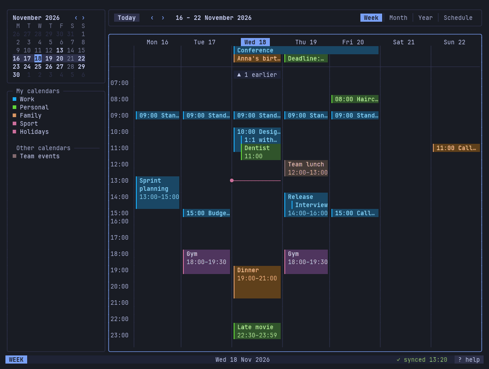

# tcal

[](https://gslama12.github.io/tcal/)
[](LICENSE)

A keyboard-driven calendar for the terminal that syncs with iCloud: vim-like keys, events
typed in words and a familiar layout. It works offline too: edits are queued and
synced in the background. Built with [Textual](https://textual.textualize.io/).

<p align="center">
  
</p>

## Features

- **Four views** — week (`w`, zoom with `+` / `-`), month (`m`), year (`Y`) and schedule (`s`), next to a sidebar with a mini month (`M`) and your calendars (`c`, `space` shows or hides one).
- **Events in words** — `a` types a new event in one line, like `Lunch with Anna tomorrow 12:30-13:30 @Cafe #personal` or `Gym every tue 18:00 for 1h`, with a live preview ([syntax](https://gslama12.github.io/tcal/guide/typing-events)).
- **Event form** — `e` edits an event [field by field](https://gslama12.github.io/tcal/guide/editing-events); recurring events ask for "this event" or "all events", invitees and alerts are kept.
- **Event navigation** — in the week, `h` `j` `k` `l` jump from event to event; `v` switches to a grid cursor for empty slots.
- **Flash jumps** — `f` labels every event and slot of the week on screen; type a label and the cursor is there.
- **Move and resize** — `J` / `K` move a timed event by 15 minutes, `<` / `>` by a day; `o` resizes it.
- **Copy and paste** — `y` / `p` copy and paste, `D` duplicates to the next day; mark several events with `tab` to copy them together.
- **Undo** — `u` / `ctrl+r` undo and redo the last 20 changes, on iCloud too.
- **Go to and search** — `g` jumps to `fri`, `+2w`, `24.12.` or `dec`; `/` searches your events.
- **Subscriptions** — holidays, sports and other read-only calendars from any iCalendar URL.

> [!TIP]
> **Press `?` for a list of every key**, always matching your config. More in the [documentation](https://gslama12.github.io/tcal/).


## Install

Needs Python 3.11+, Jet Brains Mono Nerd Font and [uv](https://docs.astral.sh/uv/).

```bash
git clone https://github.com/gslama12/tcal
cd tcal
uv tool install .
tcal --demo  # sample data, no account needed
```

Also check out the [installation guide](https://gslama12.github.io/tcal/guide/installation) and
[getting started](https://gslama12.github.io/tcal/guide/getting-started).


## iCloud setup

1. Create an **app-specific password** at [appleid.apple.com](https://appleid.apple.com) →
   *Sign-In and Security* → *App-Specific Passwords* (your normal Apple ID password won't work).
2. Run `tcal login` and enter your Apple ID e-mail and that password, which is kept in the
   system keyring (macOS Keychain).
3. Start `tcal`.

If something doesn't work, `tcal doctor` checks the setup step by step. See
[iCloud](https://gslama12.github.io/tcal/guide/icloud) and
[Troubleshooting](https://gslama12.github.io/tcal/reference/troubleshooting).

> [!TIP]
> For Google Calendar support, just ask your agent to write it and open a PR. Currently only Apple Calendar is supported.

## Configuration

Keys, theme, views, sync and subscriptions are set in `~/.config/tcal/config.toml`, on top of the
[defaults](tcal/default_config.toml). `tcal config edit` opens it, `tcal config check` validates it.

```toml
[theme]
name = "nord"              # default: tokyo-night

[keys]
new_event = ["n"]          # replaces all default keys of that action

[[subscription]]
name = "Feiertage"
url = "https://calendars.icloud.com/holidays/at_de.ics"
```

Every setting is listed in [Configuration](https://gslama12.github.io/tcal/reference/configuration),
every key in [Keybindings](https://gslama12.github.io/tcal/guide/keybindings).

> Setting `TCAL_HOME` keeps config and data in that one directory instead, giving a fully isolated instance.


## Development

```bash
uv sync
uv run tcal --demo
uv run pytest -q
uv run ruff check && uv run ruff format --check && uv run mypy
```

Tests need no network or keyring. Architecture and decisions are in [docs/PLAN.md](docs/PLAN.md).


## License

[MIT](LICENSE)
